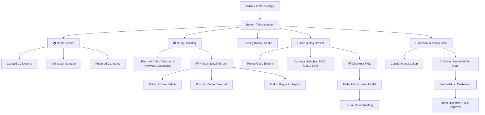

# 🎨 FUNNY ARC — Mobile Application Architecture & Generation Plan for Google AI Studio

> **Application Name**: **FUNNY ARC**  
> **Platform Target**: React Native (Expo SDK 52+ / NativeWind Tailwind CSS) or Flutter  
> **Backend Integration**: Node.js / Express + MongoDB Atlas (`server/index.js`)  
> **Target LLM**: Google AI Studio (Gemini 1.5 Pro / Gemini 2.0 Flash or Pro)  
> **Companion Bundle**: `funny-arc-ai-studio.zip` (or `zaytoun-atelier-ai-studio.zip`)

---

## 1. Executive Summary & Brand Identity

**FUNNY ARC** is a bespoke, ultra-luxury couture and contemporary fashion atelier. The mobile application replicates the desktop and web experience into a native iOS and Android application with fluid haptics, gesture interactions, and luxury aesthetics.

### 🎨 Color Palette & Design System
* **Pure White (`#FFFFFF`)**: Primary canvas, high-contrast modal backdrops, minimalist spacing.
* **Camel & Warm Caramel (`#C19A6B` / `#D4A373` / `#9A6E3E`)**: Brand accent, primary action buttons, active tab indicators, and luxury badges.
* **Onyx & Charcoal (`#1A1A1A` / `#111113`)**: Luxury headings, dark contrast elements, and bottom sheet handles.
* **Cream & Ivory Linen (`#FAF7F2` / `#FAF6F0`)**: Card backgrounds, surface elevation, and pill badges.
* **Emerald (`#10B981` / `#059669`)**: Approved orders, dispatch status, and verified client badges.

### 🔤 Typography & Aesthetics
* **Headings**: Editorial luxury serif style (Playfair Display / Cormorant Garamond).
* **Body / UI**: Clean geometric sans-serif (Inter / Outfit / SF Pro).
* **Mono / Telemetry**: JetBrains Mono or Space Mono for order IDs, consignment tracking numbers, and receipt dossier details.
* **Status Strings**: Strictly **lowercase** throughout all screens and API payloads (`pending`, `approved`, `processing`, `shipped`, `delivered`, `cancelled`).

---

## 2. Navigation Architecture

---

## 3. Screen Specifications & User Flows

### A. 🏠 Home Screen
* **Hero Carousel / Showcase**: Bold typography `FUNNY ARC`, high-resolution campaign banner, smooth parallax scrolling.
* **Curated Collections**: Grid and horizontal scroll showcasing tailored outerwear, pleated trousers, knitwear, and accessories.
* **Animated Infinite Marquee**: Dynamic running banner displaying brand ethos, runway announcements, and drop status.
* **Featured Products**: Tap to open the Product Detail stack screen.

### B. 🛍️ Shop & Catalog Screen
* **Category Filter Bar**: Pills for `All`, `Men`, `Women`, `Outerwear`, and `Knitwear`.
* **Search & Debounce**: Instant search by garment title, style code, or fabric composition.
* **Product Card Component**:
  - Image carousel or flat lay preview.
  - Title, category subtitle, price formatted in active currency (`PKR`, `USD`, `EUR`).
  - Tactile quick-add button with spring animation.

### C. 👗 Fitting Room / Studio (Interactive Customizer)
* **Mannequin & Look Builder**: Translating `formeEngine.js` and `FittingRoom.jsx` into native mobile views.
* **Slot Switching**: Top, Bottom, Outerwear, Footwear.
* **Fabric & Color Variant Selector**: Real-time asset layering and look coordination.
* **"Try On & Order Look"**: Seamlessly pushes curated look items into the cart.

### D. 🛒 Cart & Bag (Slide-up Bottom Sheet)
* **Bottom Sheet Gesture**: Drag-to-dismiss sheet with spring physics.
* **Line Items**: Product thumbnail, name, selected size, color, quantity stepper (`- / +`), remove item.
* **Promo Code Field**: Validates coupons (e.g. `ATELIER10`, `FOOLISH15`).
* **Multi-Currency Converter**: Live price updates across PKR, USD, EUR, GBP.
* **Checkout CTA**: Haptic feedback on button press, sliding directly into the Checkout Flow.

### E. 📦 Product Detail Stack Screen
* **Media Viewer**: High-res pinch-to-zoom multi-angle gallery.
* **Size & Fit Selector**: `XS`, `S`, `M`, `L`, `XL` with visual stock indication.
* **Accordions / Modals**:
  - Fabric composition (e.g., Raw Silk, 13.5oz Selvedge Denim, Ring-Spun Cotton).
  - Garment care instructions.
* **Sticky Bottom Bar**: Price display + "Add to Bag" button.

### F. 💳 Checkout & Order Confirmation Flow
* **Customer Info Form**: First Name, Last Name, Email, Phone, Delivery Address, City, Province.
* **Payment Selector**:
  - Cash on Delivery (COD).
  - JazzCash / EasyPaisa / Bank Transfer with payment proof screenshot attachment.
* **Order Placement**: Submits order to Node.js / MongoDB Atlas API (`POST /api/orders`).
* **Confirmation View**: Displays Order Reference `#ZYT-2026-XXXX`, order manifest, and direct button to Track Order.

### G. 📍 Live Order Tracking Screen (`/track/:orderId`)
* **Live Lookup**: Input Order ID or load directly from order history.
* **Dynamic Stepper Progress**:
  - `pending` $\rightarrow$ Studio Verification.
  - `approved` $\rightarrow$ Tailoring & Consignment Verified.
  - `processing` / `dispatched` $\rightarrow$ Handed over to TCS Express.
  - `delivered` $\rightarrow$ Delivered to client destination.
* **Consignment State Simulator**: Demo buttons rendered in clean lowercase to test different states.
* **Client Review Submission**: 5-star rating, fit assessment, and comments.

### H. 🔐 Admin Gate & Studio Dashboard (`/admin` / `/studio`)
* **Strict Security**: Restricted to verified owner email (`shaahrozdogar@gmail.com`).
* **Orders Management**:
  - Filter orders by lowercase statuses: `all`, `pending`, `approved`, `processing`, `shipped`, `delivered`, `cancelled`.
  - **Inline Status Dropdown**: Switch order status instantly.
  - **One-Click Approval**: `Approve & Dispatch TCS` assigns an authentic TCS consignment tracking number and opens WhatsApp with a pre-formatted client message.
  - **Dossier & Transcript Modal**: Complete order manifest, customer details, and downloadable `.txt` transcript.
* **Product Catalog Editor**: Add, edit stock, update pricing, or remove garments.

---

## 4. API & Backend Integration Contract

The mobile app connects to the existing Node.js / Express backend (`server/index.js`):

| Endpoint | Method | Description |
| :--- | :---: | :--- |
| `/api/products` | `GET` | Fetch all garments from MongoDB Atlas |
| `/api/products` | `POST` | Add/update garment in catalog |
| `/api/orders` | `POST` | Place new client order |
| `/api/orders/:orderNumber` | `GET` | Lookup order by order ID or tracking number |
| `/api/orders/:id/status` | `PATCH` | Update order status (normalized lowercase) |
| `/api/orders/:id/approve` | `POST` | Approve order, assign TCS tracking, notify client |
| `/api/theme` | `GET` | Fetch live theme and brand configuration |

---

## 5. Google AI Studio Prompt Implementation Steps

1. **Step 1**: Use the companion prompt file `AI_STUDIO_PROMPT.md`.
2. **Step 2**: In Google AI Studio, upload `funny-arc-ai-studio.zip` (or `zaytoun-atelier-ai-studio.zip`).
3. **Step 3**: Gemini will generate the complete Expo / React Native codebase with NativeWind styling.
